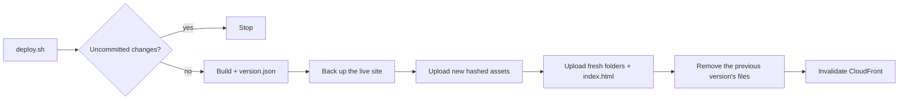

# S3 + CloudFront deploys with backups and one-command rollback


Bash scripts that deploy a static site or single-page app to **AWS S3 + CloudFront** safely: only committed code goes live, caching is correct, visitors never hit a half-deployed site, and every deploy can be rolled back with one command. The test suite runs against a **simulated S3**, so it needs no AWS account.

## What it does



- **Committed code only.** Refuses to deploy uncommitted changes and warns about unpushed commits. `version.json` on the live site records the commit, branch, tag and time.
- **Correct caching.** Hashed assets are cached for a year; `index.html`, `version.json` and configured “fresh” folders are always revalidated. Only the paths that need it are invalidated.
- **No broken windows mid-deploy.** New files go up first, `index.html` next, and old files are removed last, so a visitor never loads a page that points at a deleted file.
- **Automatic backups.** The live site is saved to `backups/<time>_<commit>/` before every deploy; the newest N are kept.
- **One-command rollback.** `restore.sh` puts any backup back live after a typed confirmation, and backs up the current version first, so a rollback can be undone too.
- **Protected prefixes.** Bucket folders written by something else (user uploads, say) are never deleted or copied into backups.
- **Least privilege.** The [IAM policy](iam/deploy-policy.json) allows exactly what the scripts do.

## Use it in a project

```bash
cp deploy.env.example /path/to/your-project/deploy.env   # set BUCKET and DIST_ID
echo "deploy.env" >> /path/to/your-project/.gitignore
echo "backups/" >> /path/to/your-project/.gitignore

cd /path/to/your-project
bash /path/to/scripts/deploy.sh             # deploy
bash /path/to/scripts/restore.sh            # roll back to the newest backup
bash /path/to/scripts/restore.sh <name>     # or a specific one (ls backups)
```

Or add `"deploy": "bash scripts/deploy.sh"` to `package.json` after copying `scripts/` into the project. One-time AWS setup (bucket, CloudFront, SPA routing, credentials): [docs/cloudfront-setup.md](docs/cloudfront-setup.md).

Needs bash (3.2+ works, so macOS’s default is fine), git and the AWS CLI.

## Tests

```bash
bash test/run-tests.sh
```

23 end-to-end checks drive the real scripts against [`test/fake-aws.mjs`](test/fake-aws.mjs), which treats a folder as S3 and logs every command so the upload order can be verified. They cover refusing dirty trees, first and repeat deploys, backup contents and naming, removal of old assets, protected prefixes, upload order, invalidation paths, restore, cancel, pruning, overrides and missing config. Needs Node 18+ for the fake CLI.

The suite catches regressions: making the first sync delete old files fails exactly “uploads index.html before removing old files”, and dropping prefix protection fails exactly “never touches protected prefixes”.

## Files

| Path | What it is |
| --- | --- |
| `scripts/deploy.sh` | Git checks, build, `version.json`, backup, upload, invalidate, prune |
| `scripts/restore.sh` | Choose a backup, confirm, back up current, upload, invalidate |
| `scripts/lib.sh` | Shared upload order, caching rules, backup and prune logic |
| `deploy.env.example` | Configuration with defaults |
| `iam/deploy-policy.json` | Least-privilege IAM policy |
| `docs/cloudfront-setup.md` | Bucket, OAC, SPA error responses, cache table |
| `example/` | A tiny site with a content-hashed build, used by the tests |
| `test/` | Fake AWS CLI and the end-to-end suite |

## Limitations

- Backups live on the machine that deploys. Tag releases in git as a second safety net.
- Deploys from a laptop; for CI, run the same script with credentials from your CI’s secret store.
- Deletes use the asset sync’s view of the bucket, so two people deploying at the same time can interfere. Deploy from one place.

## How this was built

Built through AI pair programming with Claude (Anthropic). I defined the requirements, used it for real deployments, and reviewed and tested the result; Claude wrote most of the code.

## License

MIT
