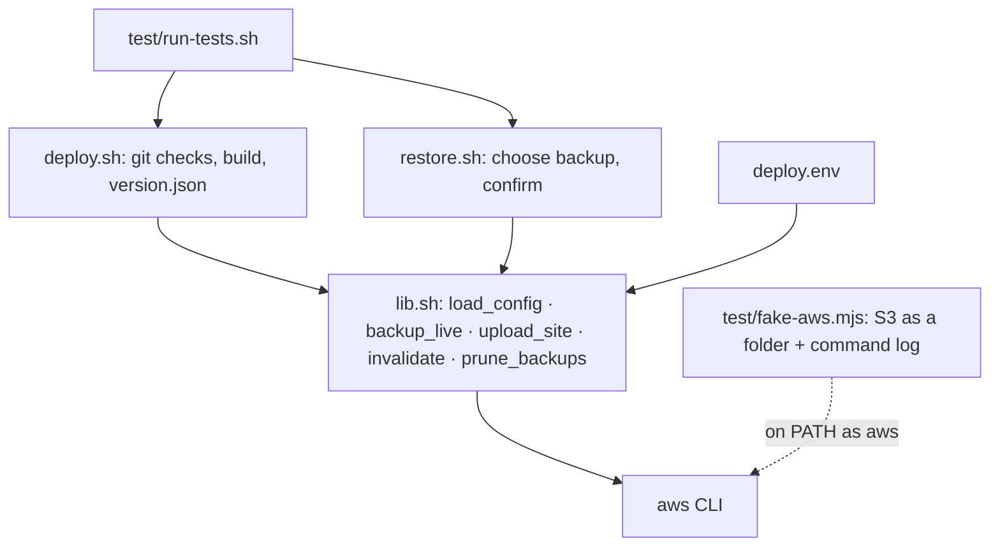

# Architecture

## Structure

Both entry points are thin: they decide *what* to deploy, and `lib.sh` decides *how*. Deploy and restore therefore can’t drift apart. A restore uploads a backup with exactly the same ordering and cache rules as a deploy.

## Design patterns and techniques

| Pattern | Where | Problem it solves |
| --- | --- | --- |
| **Shared library, thin entry points** | `lib.sh` used by `deploy.sh` and `restore.sh` | One implementation of upload order and caching for both directions |
| **Configuration over code** | `deploy.env`: `FRESH_DIRS`, `PROTECTED_PREFIXES`, `BUILD_CMD`… | Works for any static site without editing the scripts |
| **Ordered, idempotent steps** | `upload_site`: add new → update entry point → remove old | Visitors never load a page that references a deleted file; re-running is safe |
| **Guard clauses** | Git cleanliness, missing config, missing build output, typed confirmation | Fail early with a clear message instead of a half-done deploy |
| **Snapshot before change** | `backup_live` runs before every upload, including restores | Every change can be undone, including an undo |
| **Self-describing release** | `version.json` | Anyone can see which commit is live without access to AWS |
| **Least privilege** | `iam/deploy-policy.json` | The deploy credentials can’t touch anything else in the account |
| **Test double** | `fake-aws.mjs` | End-to-end tests of the real scripts without AWS, cost or credentials |
| **Mutation testing (manual)** | Breaking the script on purpose | Confirms each test fails for the bug it claims to catch |

## Key decisions

**Bash, not a deploy tool.** The AWS CLI already does the transfers. Bash keeps the logic visible and runs anywhere with no install, including macOS’s bash 3.2, which is why the scripts avoid bash 4 features.

**Two syncs instead of one.** A single `sync --delete` would remove old files before `index.html` is replaced. Syncing without deletion, uploading `index.html`, then syncing again with deletion keeps every intermediate state valid.

**Immutable caching for hashed assets only.** A file name that changes with its content can be cached forever. Everything that keeps its name (`index.html`, data folders) is revalidated, and only those paths are invalidated.

**Backups on the deploying machine.** It’s simple and free, and the data is small. The trade-off is that backups don’t follow you to another machine, so git tags are the second safety net.

**Protected prefixes are excluded everywhere.** The same exclusion list feeds the deletes and the backups, so a folder written by something else can’t be removed by a deploy or restored over newer data.

## Alternatives considered

| Alternative | Why not here |
| --- | --- |
| S3 bucket versioning for rollback | Restores objects one by one; a whole-site rollback becomes a script anyway, and versions cost storage |
| Infrastructure-as-code tools (CDK, Terraform) for deploys | Right for creating the bucket and distribution; overkill for copying files |
| One `aws s3 sync --delete` | Briefly breaks the site between deleting old files and uploading the new entry point |
| Invalidating `/*` on every deploy | Works, but throws away the cache for files that didn’t change |
